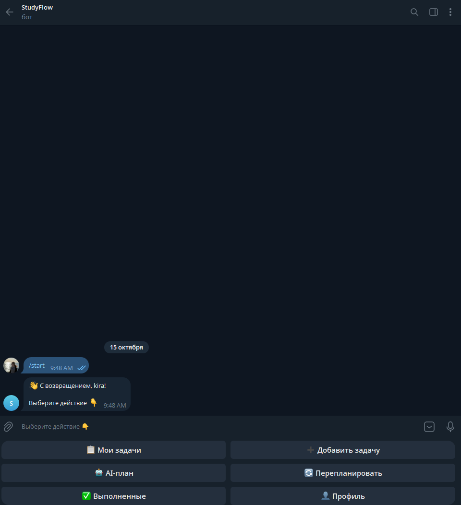
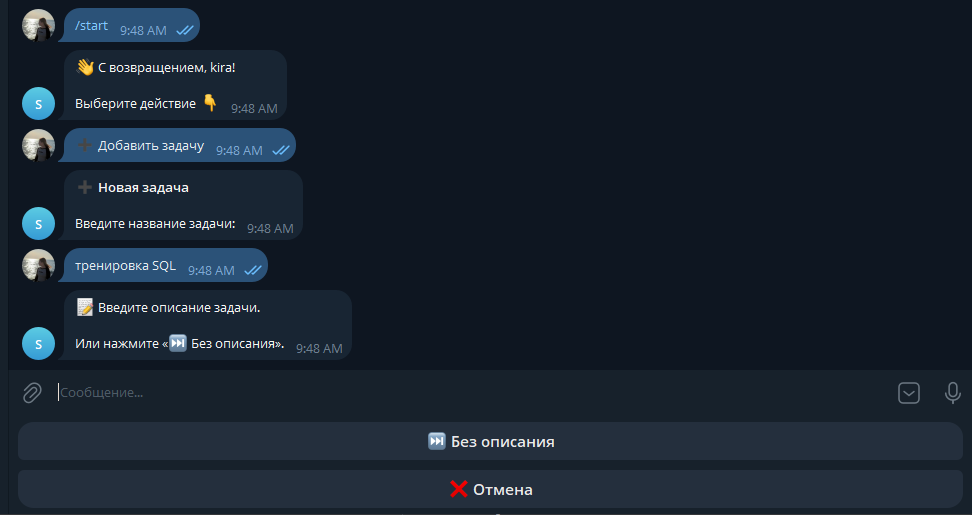
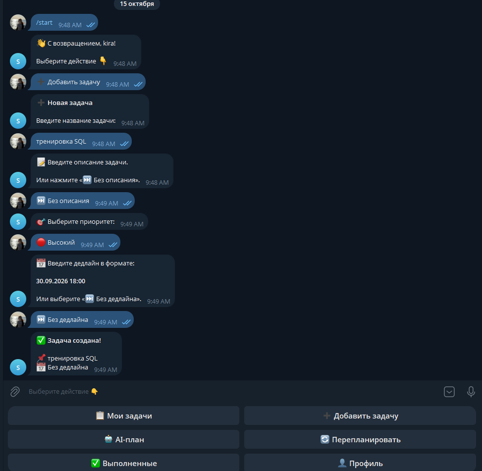
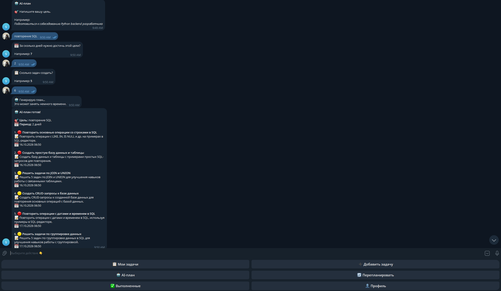
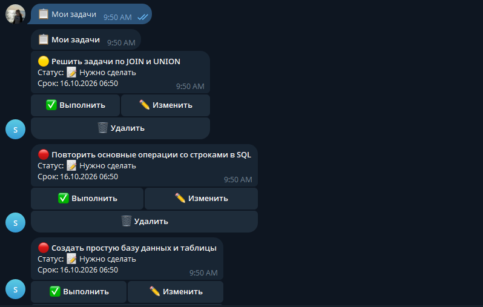
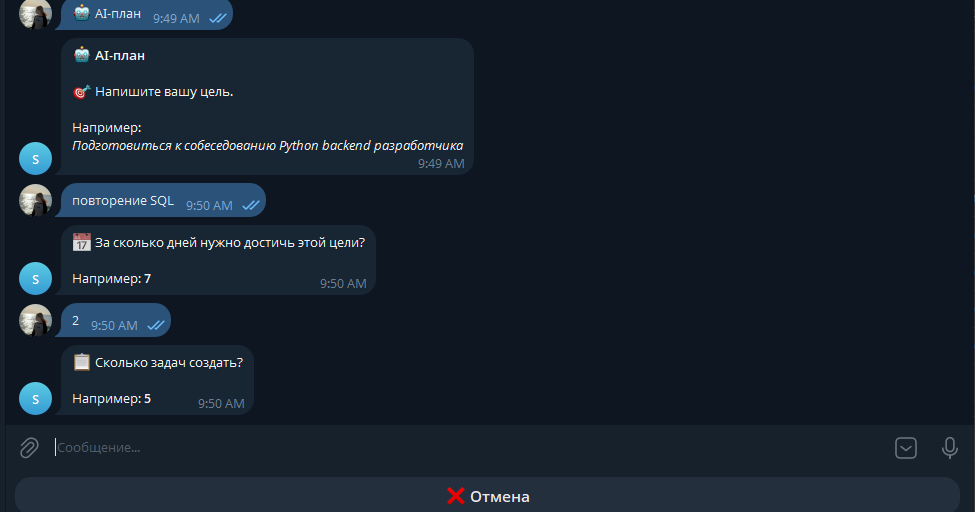

# StudyFlow Bot

StudyFlow — backend-проект на Python для управления задачами и планирования учебной или рабочей нагрузки через REST API и Telegram-бота. Проект использует локальную AI-модель для генерации учебных планов и перепланирования незавершённых задач.

**Статус проекта:** приложение работает в локальном окружении. Публичный сервер для постоянной работы пока не развёрнут. Исходный код доступен для изучения и самостоятельного запуска.

**GitHub:** https://github.com/Kira65536/StudyFlow

## Возможности

- Регистрация и авторизация пользователей.
- JWT-аутентификация.
- CRUD-операции с задачами: создание, просмотр, редактирование и удаление.
- Управление статусами, приоритетами и дедлайнами.
- Telegram-бот на Aiogram 3.
- Привязка Telegram-аккаунта к пользователю StudyFlow.
- Генерация учебных планов с помощью AI.
- Предварительный просмотр и сохранение сгенерированных задач в PostgreSQL.
- Перепланирование незавершённых задач.
- Интеграция с локальной AI-моделью через Ollama.
- Миграции базы данных через Alembic.
- Автоматические тесты с Pytest.

## Демонстрация

### Главное меню

Главное меню Telegram-бота предоставляет доступ к задачам, добавлению новых задач, генерации AI-плана, перепланированию, выполненным задачам и профилю.



### Создание задачи

Пользователь проходит пошаговый сценарий создания задачи: указывает название, описание, приоритет и дедлайн. Описание и дедлайн можно пропустить.



### Результат создания задачи

После заполнения параметров бот подтверждает создание задачи и возвращает пользователя в главное меню.



### Генерация учебного плана с помощью AI

Пользователь задаёт цель, продолжительность плана и количество задач. Модель генерирует структурированный план с названиями задач, описаниями, приоритетами и сроками. Перед сохранением результат можно просмотреть.



### Управление задачами

В разделе «Мои задачи» пользователь может просматривать задачи и выполнять доступные действия: отмечать выполнение, редактировать или удалять их.



### Настройка AI-плана

Перед генерацией бот последовательно запрашивает цель, количество дней и количество задач.



## Технологический стек

| Категория | Технологии |
|---|---|
| Язык | Python 3.12 |
| Backend | FastAPI, Uvicorn |
| База данных | PostgreSQL |
| ORM и миграции | SQLAlchemy 2.0, Alembic |
| Авторизация | JWT, PyJWT, pwdlib |
| Telegram | Aiogram 3 |
| AI | Ollama, локальная LLM |
| Тестирование | Pytest, HTTPX |
| Контейнеризация | Docker, Docker Compose |

## Архитектура проекта

```text
studyflow/
├── bot/
│   ├── handlers/
│   │   ├── common.py
│   │   ├── auth.py
│   │   ├── tasks.py
│   │   ├── ai.py
│   │   └── profile.py
│   ├── bot.py
│   ├── keyboards.py
│   └── states.py
├── routers/
│   ├── auth.py
│   ├── tasks.py
│   └── ai.py
├── services/
│   └── ai_service.py
├── tests/
├── migrations/
├── app.py
├── database.py
├── dependencies.py
├── models.py
├── schemas.py
├── security.py
├── alembic.ini
├── requirements.txt
├── Dockerfile
├── docker-compose.yml
├── .env.example
└── README.md
```

## Запуск проекта

### Требования

Для запуска понадобятся:

- Git;
- Docker Engine и Docker Compose;
- Telegram-аккаунт для создания собственного бота;
- Ollama и модель `qwen2.5:3b` для AI-функций.

Инструкция ниже рассчитана прежде всего на Linux/WSL с конфигурацией сети, соответствующей текущему `docker-compose.yml`.

### 1. Клонирование репозитория

```bash
git clone https://github.com/Kira65536/StudyFlow.git
cd StudyFlow
```

### 2. Настройка Telegram-бота

Создайте собственного бота через [@BotFather](https://t.me/BotFather) и получите токен.

Создайте файл `.env` на основе шаблона:

```bash
cp .env.example .env
```

Заполните необходимые переменные:

```env
DATABASE_URL=
JWT_SECRET=replace-with-a-long-random-secret
TELEGRAM_BOT_TOKEN=your-own-telegram-bot-token
TELEGRAM_PROXY=
```

- `DATABASE_URL` — строка подключения к базе данных. В текущем Docker Compose адреса подключения API и бота задаются в конфигурации сервисов.
- `JWT_SECRET` — случайный секретный ключ для подписи JWT-токенов.
- `TELEGRAM_BOT_TOKEN` — токен собственного Telegram-бота.
- `TELEGRAM_PROXY` — необязательный прокси для подключения к Telegram. Если прокси не нужен, переменную можно оставить пустой.

**Не публикуйте `.env`, токены и секретные ключи в GitHub.**

### 3. Установка Ollama

Установите Ollama по инструкции на [официальном сайте](https://ollama.com/).

Загрузите модель:

```bash
ollama pull qwen2.5:3b
```

Проверьте, что модель установлена:

```bash
ollama list
```

API в Docker обращается к Ollama по адресу `host.docker.internal:11434`. Для работы AI-функций Ollama должна быть запущена, а сетевой доступ к ней из API-контейнера должен быть настроен.

Текущая конфигурация Ollama рассчитана на локальную среду. Не открывайте порт Ollama для недоверенных сетей.

### 4. Запуск Docker Compose

Из корня проекта выполните:

```bash
docker compose up -d --build
```

PostgreSQL запускается в отдельном контейнере. При запуске API применяются миграции Alembic, после чего запускается Uvicorn.

Проверьте состояние контейнеров:

```bash
docker compose ps
```

Посмотрите логи:

```bash
docker compose logs --tail=100 api
docker compose logs --tail=100 bot
docker compose logs --tail=100 db
```

В текущей конфигурации Telegram-бот использует `network_mode: host` и подключается к PostgreSQL через `127.0.0.1:15432`. Поэтому сетевые настройки могут потребовать адаптации на других операционных системах и компьютерах.

### 5. Проверка API

Swagger UI:

http://localhost:8000/docs

Проверка состояния API:

http://localhost:8000/health

PostgreSQL публикуется на порту `15432` хост-машины. API внутри Docker подключается к сервису `db` на порту `5432`.

### 6. Остановка проекта

```bash
docker compose down
```

Данные PostgreSQL сохраняются в Docker volume `postgres_data`.

Команда ниже удаляет контейнеры и сохранённые данные базы:

```bash
docker compose down -v
```

Используйте её только тогда, когда действительно хотите удалить данные.

## AI-функции

### Генерация плана

Пользователь указывает учебную цель, продолжительность плана и количество задач. AI формирует список задач, который можно предварительно просмотреть и сохранить в PostgreSQL.

### Перепланирование

StudyFlow поддерживает перепланирование незавершённых задач с корректировкой плана и сроков.

### Локальная модель

Для генерации используется Ollama с моделью `qwen2.5:3b`. Модель запускается отдельно от API и должна быть доступна по настроенному адресу.

## Тестирование

Активируйте виртуальное окружение и установите зависимости:

```bash
python -m venv .venv
source .venv/bin/activate
pip install -r requirements.txt
```

Запустите тесты:

```bash
pytest -v
```

Последняя зафиксированная проверка: **31 тест пройден**. Результаты тестирования могут меняться после обновления кода и зависимостей.

## Безопасность

- Секреты хранятся в локальном `.env`, который не должен попадать в Git.
- `.env.example` содержит только шаблон переменных окружения.
- Для JWT используется секретный ключ из конфигурации приложения.
- Пароли пользователей должны храниться в виде хешей.
- Не предоставляйте публичный доступ к Ollama без необходимости и сетевых ограничений.

## Цель проекта

StudyFlow создан для практики backend-разработки на Python и демонстрации навыков работы с REST API, PostgreSQL, SQLAlchemy, миграциями, авторизацией, Telegram-ботами, локальными AI-моделями, Docker и автоматизированным тестированием.

## Дальнейшее развитие

- Развёртывание на сервере для постоянной доступности.
- Улучшение обработки ошибок и логирования.
- Расширение AI-функций.
- Настройка CI для автоматического запуска тестов.